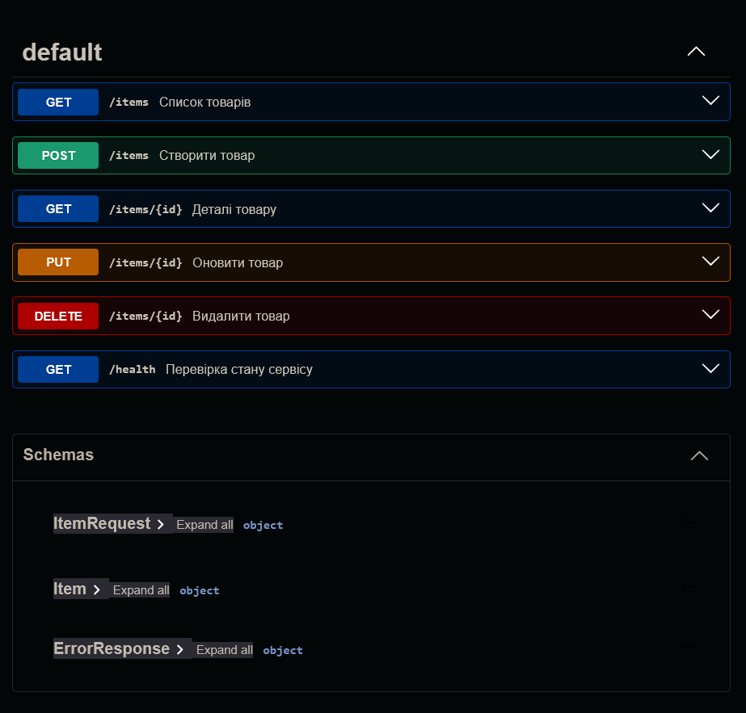

# Online Shop

Невеликий онлайн-магазин: веб-клієнт, бекенд на Node.js (Express) і база даних SQLite.

## Можливості

- Каталог товарів: повний CRUD (`/items`)
- Створення замовлень з ідемпотентністю (`POST /orders`)
- Єдиний формат помилок, `X-Request-Id` у кожній відповіді
- Rate-limit з `Retry-After` (429) для `/orders`
- Клієнт з таймаутом, ретраями (backoff + jitter) і degraded mode
- `GET /health` для перевірки стану сервісу

## Технології

Node.js, Express 5, better-sqlite3 (SQLite), HTML/JS (без фреймворків), Docker.

## Архітектура

Модульний моноліт із шарами `api -> service -> domain`.

```
online-shop/
├── api/         роути, обробка помилок, rate-limit, X-Request-Id
├── service/     бізнес-логіка й валідація
├── domain/      сутності (Product, Order, User, ...)
├── client/      веб-інтерфейс
├── test/        юніт-тести
├── docs/        документація, ADR, діаграми, OpenAPI
├── schema.js    схема БД і тестові дані
├── db.js        підключення до SQLite
├── server.js    точка входу
├── Dockerfile
└── .dockerignore
```

## Запуск локально

Потрібно: Node.js 18 або новіший.

```bash
npm install
npm start
```

Застосунок: http://localhost:3000

База `shop.db` створюється автоматично при першому запуску з чотирма тестовими товарами.

### Змінні оточення

| Змінна | За замовчуванням | Призначення |
|---|---|---|
| `FAIL_RATE` | `0.2` | Імовірність імітованої помилки 500/503 для `/orders` |
| `SLOW_RATE` | `0.15` | Імовірність імітованої повільної відповіді для `/orders` |

Запуск без збоїв:

```bash
FAIL_RATE=0 SLOW_RATE=0 npm start
```

(у PowerShell: `$env:FAIL_RATE=0; $env:SLOW_RATE=0; npm start`)

## API

| Метод | Шлях | Опис | Коди |
|---|---|---|---|
| GET | `/health` | Стан сервісу, `{"status":"ok"}` | 200 |
| GET | `/items` | Список товарів | 200 |
| POST | `/items` | Створити товар | 201, 400 |
| GET | `/items/{id}` | Деталі товару | 200, 404 |
| PUT | `/items/{id}` | Оновити товар | 200, 400, 404 |
| DELETE | `/items/{id}` | Видалити товар | 204, 404 |
| POST | `/orders` | Створити замовлення (потрібен `Idempotency-Key`) | 201, 400, 429, 5xx |

Приклад помилки:

```json
{ "error": "ValidationError", "code": "VALIDATION_FAILED",
  "details": [{ "field": "name", "message": "Name is required" }],
  "requestId": "..." }
```

## API документація

Контракт API: [docs/api/openapi.yaml](docs/api/openapi.yaml)



Контракт перевірено в https://editor.swagger.io/

## Перевірка ідемпотентності

```bash
IDEM=$(node -e "console.log(crypto.randomUUID())")
curl -i -X POST localhost:3000/orders -H "Content-Type: application/json" -H "Idempotency-Key: $IDEM" -H "X-Request-Id: demo-1" -d '{"title":"Buy milk"}'
curl -i -X POST localhost:3000/orders -H "Content-Type: application/json" -H "Idempotency-Key: $IDEM" -H "X-Request-Id: demo-2" -d '{"title":"Buy milk"}'
```

Обидві відповіді повертають 201 з однаковим `id`.

## Тести

```bash
npm test
```

Юніт-тести рівня `service/`: успішне створення, помилка валідації, ідемпотентність замовлень.

## Docker

### Перевірка Docker

```bash
docker version
docker run hello-world
```

### Збірка і запуск

```bash
docker build -t online-shop:1.0.0 .
docker run --name online-shop --rm -d -p 3000:3000 online-shop:1.0.0
docker logs online-shop
docker stop online-shop
```

Застосунок доступний на http://localhost:3000

Перевірка:

```bash
docker ps
curl http://localhost:3000/health
curl http://localhost:3000/items
```


## Документація

- [Бізнес-документ](docs/business_doc.md)
- [Roadmap](docs/roadmap.md)
- Архітектурна діаграма: `docs/architecture_diagram.png`
- Domain-Driven Design: [сутності](docs/domain/entities.md), [глосарій](docs/domain/glossary.md), `docs/domain/context_map.png`
- ADR: [0001 стиль архітектури](docs/adr/0001-architecture-style.md), [0002 шари](docs/adr/0002-layered-architecture.md), [0003 стиль API і помилки](docs/adr/0003-api-style-and-error-model.md)

## Git-процес

Зміни вносяться у окремих гілках через pull request з подальшим merge у `main`.

